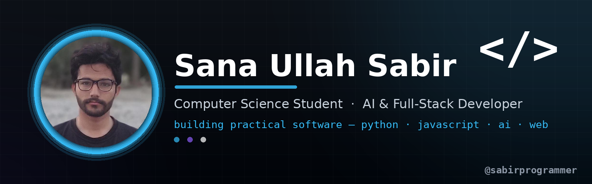

 

---

## About Me

I'm a computer science student and developer focused on building **practical, production-ready software**. I work across the stack — from machine-learning and computer-vision pipelines to modern full-stack web applications — and I care about writing clean, secure, maintainable code.

- Currently deepening my skills in **agentic AI**, **full-stack architecture**, and **applied machine learning**
- Interested in **AI-powered products**, **web application security**, and **computer vision**
- Open to collaborating on student, open-source, and portfolio projects

 

---

## Tech Stack

**Languages**

**Frontend**

**Backend & Databases**

**AI / ML & Computer Vision**

**Tools & Workflow**

---

## Featured Projects

| Project | Description | Tech |
|--------|-------------|------|
| **[Personal Expense Tracker](https://github.com/sabirprogrammer/Personal_Expence_Tracker)** | Production-ready expense-management app with user & admin dashboards, authentication, reporting, and transactional analytics. | `Node.js` `Express` `MongoDB` `Chart.js` |
| **[Alyla AI Assistant](https://github.com/sabirprogrammer/ai_personal_agent)** | AI-powered productivity assistant with dashboards, scheduling workflows, and intelligent interactions. | `Next.js` `TypeScript` `React` `Tailwind` `Google GenAI` |
| **[AWASTP](https://github.com/sabirprogrammer/AWSTP)** | Educational web-application security testing platform for authorized environments, with automated reporting. | `Python` `Flask` `PyQt5` `SQLite` `ReportLab` |
| **[Human Action Recognition](https://github.com/sabirprogrammer/humannactionrecgonition)** | Real-time computer-vision system that recognizes human actions from webcam input using pose estimation and ML. | `Python` `MediaPipe` `OpenCV` `Streamlit` `scikit-learn` |

---

## Currently Learning

- **Agentic AI** — autonomous agents, tool use, and AI integrations
- **Full-stack architecture** — scalable design, deployment, and DevOps fundamentals
- **Secure software development** — web security, authentication, and testing
- **Applied ML & computer vision** — real-world model deployment

---

## GitHub Trophies

---

## GitHub Stats

---

## Contribution Activity

**Snake eating my contributions** 🐍

---

## Quote of the Day

---

## Let's Connect

*I'm always open to learning with other developers and collaborating on practical AI, web-development, and cybersecurity projects.*

